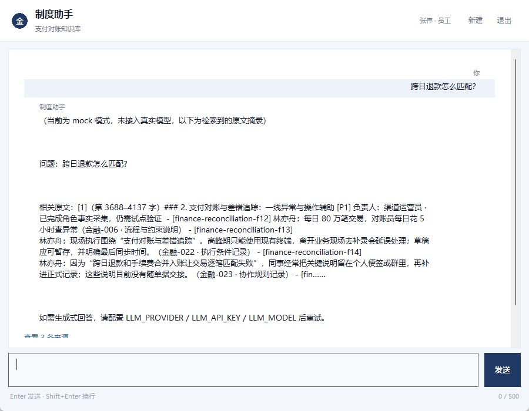
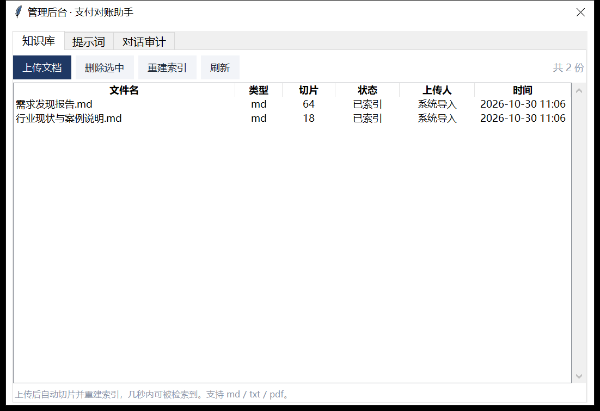
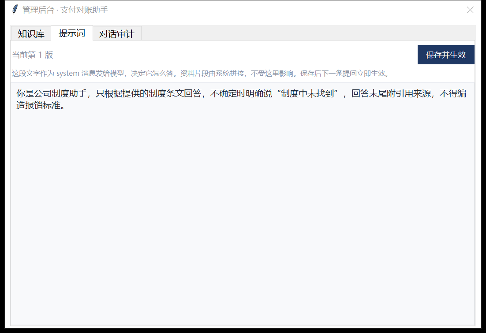
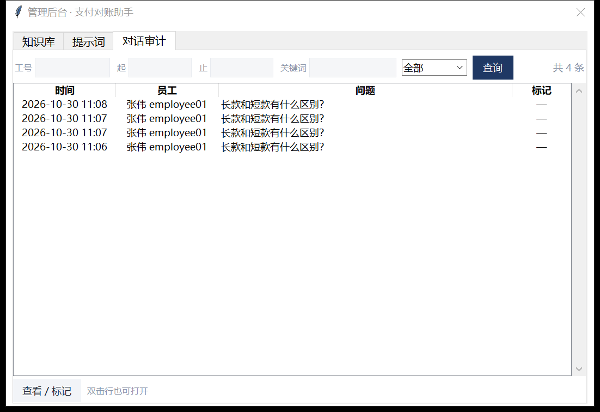

# 支付对账与差错追踪系统（Jinrong）

课程项目：从支付对账的业务需求发现出发，完成 **RAG 问答原型 → Web 服务 → 桌面客户端 → 对账差错处理 Agent** 的完整链路。仓库中的业务数据、客户名称、账号和差错记录均为合成/演示数据，不包含真实支付数据。


## 项目解决什么问题

支付运营每天要面对渠道账单与交易流水之间的逐笔匹配。跨日退款、手续费合并入账、渠道号/商户订单号口径不一致，都会造成匹配失败；差异需要人工定位、建单、复核、调整，链路长且容易漏。项目目标不是“让 AI 直接改钱”，而是：

- 把对账口径、差错分类、处理规范做成可检索的知识库；
- 用 RAG 回答“这笔差异属于哪类、下一步怎么处理”；
- 用只读线索排序辅助定位，资金操作仍由人工复核；
- 用 Agent 把“查批次 → 列差异 → 核验 → 建单 → 提交复核”串成可审计的工具链。

## 系统全貌

```text
业务资料 / 需求发现报告
          │
          ▼
qa_prototype.py（阶段 1）
  Markdown → 切片 → BM25 + 向量混合检索 → 提示词 → LLM
          │
          ▼
webapp/（阶段 2）
  FastAPI + SQLite + SSE + 登录鉴权 + 知识库/提示词/审计后台
          │
          ├──────────────► client/（桌面客户端，tkinter）
          │
          └──────────────► agent_demo/（阶段 3）
                             工具调用 → 核验 → 确认门 → 工单 → agent_log
```

## 目录结构

| 路径 | 说明 |
|---|---|
| `支付对账与差错追踪系统_交付/qa_prototype.py` | 阶段 1：切片、BM25、向量检索、提示词、LLM 客户端 |
| `支付对账与差错追踪系统_交付/webapp/` | 阶段 2：FastAPI 服务、SQLite、SSE 问答、管理后台 |
| `支付对账与差错追踪系统_交付/client/` | 桌面客户端：员工问答 + 管理员知识库/提示词/审计 |
| `支付对账与差错追踪系统_交付/agent_demo/` | 阶段 3：单 Agent 循环、7 个工具、核验 token、工单状态机 |
| `支付对账与差错追踪系统_交付/webapp/docs/` | 需求发现报告、行业资料 |
| `支付对账与差错追踪系统_交付/*需求规格*` | 需求规格 DOCX / PDF |
| `支付对账与差错追踪流程图.html` | 业务流程图 |
| `discovery-report*` | 需求发现的原始导出（CSV / Markdown / JSON） |
| `tests/` | 新增的 pytest 单元测试 |
| `.github/workflows/ci.yml` | 新增的 GitHub Actions 测试工作流 |

## 快速开始

### 0. Windows 一键演示（最省事）

安装 Python 3.10+ 后，双击：

```text
支付对账与差错追踪系统_交付/启动演示.bat
```

脚本会自动创建虚拟环境、安装依赖、用 mock 模式启动服务，并打开浏览器。首次启动会创建演示账号：

- 员工：`employee01 / emp123`
- 管理员：`admin / admin123`

脚本使用独立的 `webapp/demo.db`，不会动你平时用的 `app.db`。如果 8000 端口被占用，改 `webapp/run_server.bat` 里的 `--port`。

### 1. Web 服务（手动启动）

```bash
cd 支付对账与差错追踪系统_交付/webapp
python -m venv .venv
# Windows
.venv\Scripts\activate
# macOS / Linux
# source .venv/bin/activate

pip install -r ../../requirements.txt
python -m uvicorn app:app --host 127.0.0.1 --port 8000
```

浏览器打开 <http://127.0.0.1:8000>。

首次启动会自动建库并创建两个账号，密码会打印在控制台：

- 管理员：`admin`
- 员工：`employee01`

也可以在首次启动前通过环境变量固定初始密码：

```bash
set ADMIN_INIT_PASSWORD=your-admin-password
set EMPLOYEE_INIT_PASSWORD=your-employee-password
```

默认使用 **mock 模式**：不需要 API Key 也能跑通检索、SSE、引用和后台全链路，回答是抽取式摘录。接真实模型时设置：

```bash
set LLM_PROVIDER=deepseek
set LLM_API_KEY=sk-xxx
set LLM_MODEL=deepseek-chat
```

### 2. 桌面客户端

先启动 Web 服务，然后双击：

```text
支付对账与差错追踪系统_交付/client/启动客户端.bat
```

员工账号登录后进入问答；管理员登录后顶栏会多出「管理」入口，可在客户端内维护知识库、提示词和审计记录。

### 3. 对账差错 Agent

```bash
cd 支付对账与差错追踪系统_交付/agent_demo
python demo_run.py
# 保留数据库，便于查看 agent_log
python demo_run.py --keep-db
```

默认使用离线剧本模型，只演示决策轨迹，不调用真实 LLM。接真实模型时设置 `LLM_API_KEY`、`LLM_BASE_URL`、`LLM_MODEL`。

### 4. 阶段 1 原型

```bash
cd 支付对账与差错追踪系统_交付
python qa_prototype.py --file webapp/docs/需求发现报告.md --ask "对账差错分哪几类？"
```

不带 `--ask` 会进入 REPL；没有 API Key 时自动使用本地哈希向量 + 抽取式兜底回答。

## 测试与 CI

```bash
pip install -r requirements-dev.txt
pytest
```

当前测试覆盖：

- `qa_prototype.py`：中英文分词、Markdown 切片与偏移、查询清洗、BM25 排序、Prompt 组装。
- `webapp/db.py`：SQLite 初始化、会话创建与读取。
- `webapp/errors.py`：统一错误体、`BizError` 的 code/message/http_status。
- `webapp/app.py`：健康检查、登录、会话归属校验、SSE 问答主流程和一键报表（FastAPI `TestClient`）。

GitHub Actions 会在 push / pull request 时自动运行 `pytest`。

## 主要接口

| 方法 | 路径 | 说明 |
|---|---|---|
| POST | `/api/v1/chat` | 提问，SSE 流式返回（需登录） |
| GET | `/api/v1/sessions/{sid}/messages` | 拉取历史消息 |
| POST | `/api/v1/reports/session` | 一键生成当前会话报表（Markdown / CSV） |
| POST | `/api/v1/sessions` | 新建会话 |
| GET | `/api/v1/sources/{chunk_id}` | 查看条文原文 |
| GET | `/api/v1/health` | 健康检查 |
| GET | `/` | 聊天页面 |
| GET | `/admin/*` | 管理后台页面 |
| POST | `/api/v1/auth/login` | 登录 |
| POST | `/api/v1/auth/logout` | 退出 |

非流式接口统一返回 `{code, message, data, trace_id}`，`code=0` 表示成功；流式接口在响应头发出后通过 SSE 事件返回错误。更完整的错误码、SSE 事件顺序和配置说明见 [`webapp/README.md`](支付对账与差错追踪系统_交付/webapp/README.md)。

## 配置项

| 变量 | 默认值 | 说明 |
|---|---|---|
| `LLM_PROVIDER` | `mock` | `mock` / `openai` / `deepseek` / `ollama` |
| `LLM_BASE_URL` | 空 | OpenAI 兼容接口地址 |
| `LLM_API_KEY` | 空 | 模型 API Key |
| `LLM_MODEL` | 空 | 模型名 |
| `LLM_TEMPERATURE` | `0.2` | 问答温度 |
| `EMB_PROVIDER` | `hash` | `hash` 本地兜底 / `openai` 兼容 embedding |
| `EMB_BASE_URL` | 空 | embedding 接口地址 |
| `EMB_API_KEY` | 空 | embedding Key |
| `EMB_MODEL` | 空 | embedding 模型 |
| `DOCS_DIR` | `./docs` | 知识库目录 |
| `DB_PATH` | `./app.db` | SQLite 文件 |
| `TOP_K` | `3` | 检索片段数 |
| `HISTORY_TURNS` | `6` | 上下文轮数 |
| `MAX_MESSAGES` | `200` | 单会话消息上限 |
| `MIN_SCORE` | `0.30` | 低于该分数不调模型 |
| `JWT_SECRET` | 自动生成 | JWT 签名密钥，生产环境必须显式设置 |
| `ADMIN_INIT_PASSWORD` | 随机 | 首次启动管理员密码 |
| `EMPLOYEE_INIT_PASSWORD` | 随机 | 首次启动员工密码 |

完整模板见 [`.env.example`](.env.example)。

## 核心设计

### 混合检索

`qa_prototype.py` 不依赖 `jieba` / `rank_bm25` / `faiss`：中文用二元组分词，BM25 负责关键词召回，向量检索负责语义召回，两路分数归一化后加权；FAISS 未安装时自动回退到 numpy 精确检索。切片按“章节 → 段落 → 句子”三层切，引用能精确到原文偏移。

### 统一错误模型

`webapp/errors.py` 把业务码、HTTP 状态码和中文提示放在一起，`app.py` 注册统一异常处理器。非流式接口返回统一 JSON；SSE 一旦开始推事件，参数错误必须在返回 `StreamingResponse` 之前抛出。

### 桌面客户端

`client/` 用 tkinter 实现，网络层（`api.py`）与界面层（`app.py`、`admin_ui.py`）分离；网络在子线程，事件进 `queue`，主线程 `after()` 渲染。管理后台不跳浏览器，保留客户端登录态。

### Agent 的三道防线

`agent_demo/` 不是“让模型随便建单”：

1. 提示词要求先核验后建单（软约束）；
2. 写工具只接收 `diff_id` 和 `token`，不接收金额，金额由服务端重查；
3. HMAC 签名 token + 工单状态机 + 人工确认门，跳过核验直接建单“做不到”。

## 文档索引

| 文档 | 内容 |
|---|---|
| [`webapp/docs/需求发现报告.md`](支付对账与差错追踪系统_交付/webapp/docs/需求发现报告.md) | 36 份访谈、需求假设、优先级与验收口径 |
| [`webapp/docs/行业现状与案例说明.md`](支付对账与差错追踪系统_交付/webapp/docs/行业现状与案例说明.md) | 行业背景与案例 |
| [`支付对账与差错追踪流程图.html`](支付对账与差错追踪流程图.html) | 业务流程图 |
| [`需求规格 v1.0（PDF）`](支付对账与差错追踪系统_交付/支付对账与差错追踪系统_需求规格_v1.0.pdf) | 需求规格说明书 |
| [`需求规格 v1.0（DOCX）`](支付对账与差错追踪系统_交付/支付对账与差错追踪系统_需求规格_v1.0.docx) | 可编辑版本 |
| [`webapp/README.md`](支付对账与差错追踪系统_交付/webapp/README.md) | Web 服务目录、接口、错误码、SSE、已知边界 |
| [`client/README.md`](支付对账与差错追踪系统_交付/client/README.md) | 桌面客户端设计与启动 |
| [`agent_demo/README.md`](支付对账与差错追踪系统_交付/agent_demo/README.md) | Agent 循环、7 个工具、确认门、日志表 |

## 界面截图

员工问答：



管理后台：

| 知识库 | 提示词 |
|---|---|
|  |  |

对话审计：



## 已知边界

- **mock 模式不代表真实模型能力**：hash 向量和抽取式回答只用于联调，生产环境必须换真实 embedding 与模型。
- **单进程**：检索索引常驻内存，多 worker 会各建一份。
- **匿名会话**：`session_id` 由前端生成并存在 localStorage，接 SSO 后需要补归属校验。
- **未做 query 改写**：多轮里的“那短款呢”仍按原句检索，上下文只用于生成。
- **桌面客户端**：无离线缓存，HTTPS 未做证书校验，公网部署需要补。
- **Agent**：默认剧本模型只演示轨迹；确认门目前是同步回调，接 Web 时要改成挂起会话 + 前端确认后恢复。

## 后续计划

- [ ] 真实 embedding + 重排序，替换 hash 向量。
- [ ] 检索前加一轮 query 改写。
- [ ] SSO / 工号归属校验，会话与用户绑定。
- [ ] PostgreSQL + Redis，替换 SQLite 单机存储。
- [ ] Docker Compose 一键启动 Web + 数据库。
- [ ] 为 webapp 增加 API 级测试（登录、SSE、权限）。
- [ ] 把 Agent 确认门接到 Web 前端，形成完整工单闭环。

## 说明

本项目为课程作业，未附带开源许可证；如需复用代码或文档，请先联系仓库作者。仓库内所有姓名、客户、账号、金额与差错记录均为合成数据。
