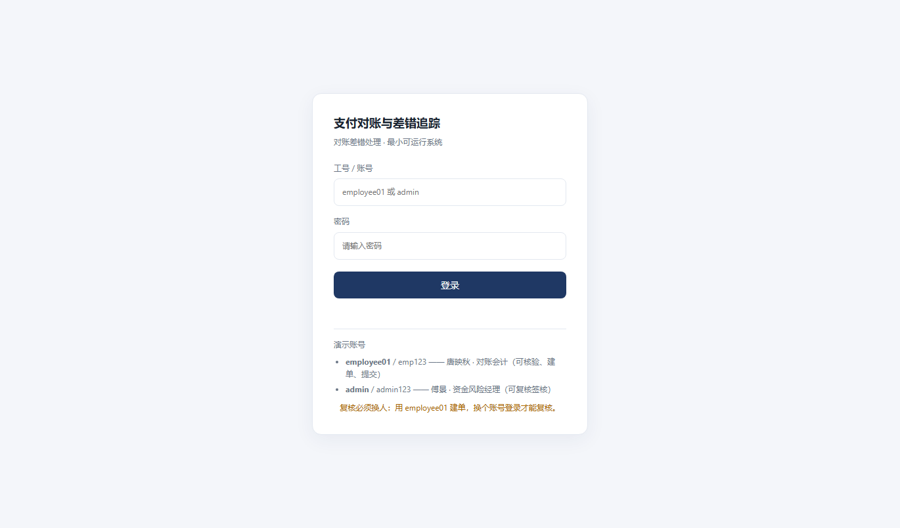
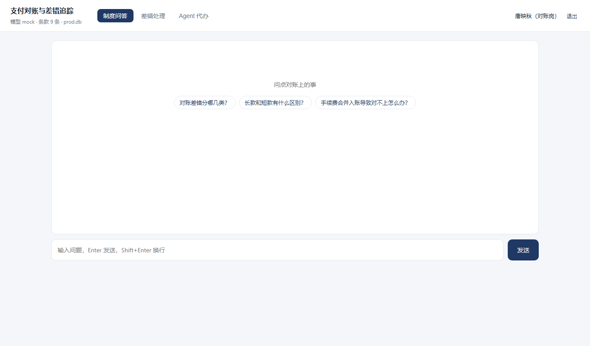

# 上线部署记录

## 一、访问地址

**https://friends-galleries-cdt-activation.trycloudflare.com**

用浏览器（Chrome / Edge / Safari 均可）直接打开，无需安装任何东西。

**需要登录**（账号由系统初始化时创建）：

| 账号 | 密码 | 角色 | 能做什么 |
|---|---|---|---|
| `employee01` | `emp123` | 对账岗（唐映秋） | 问答、查看、核验、建单、提交复核 |
| `admin` | `admin123` | 风险岗（傅景） | 以上全部 + **复核签核** |

复核必须换人：用 `employee01` 建单 → 退出 → 用 `admin` 登录 → 复核。

| 页签 | 用途 |
|---|---|
| 制度问答 | 问对账口径、差错处理规范，回答带条款引用 |
| 差错处理 | 看批次与差异、核验、建单、提交、复核 |
| Agent 代办 | 让 Agent 跑完整流程，写操作前停下等确认 |

## 二、上线信息

| 项 | 内容 |
|---|---|
| 上线时间 | 2026-11-06 10:5x（北京时间） |
| 部署方式 | Cloudflare Tunnel（临时隧道）→ 本机 127.0.0.1:8080 |
| 应用 | `src/` MVP（FastAPI + SQLite），单进程 |
| 数据 | `prod.db`，预置 9 条制度、2 渠道、2 批次、5 条差异 |
| 模型 | mock（离线摘录，未接真实模型） |
| 协议 | HTTP/2（QUIC 在本地网络不稳定，已回落） |

## 三、验证记录

| # | 检查项 | 结果 |
|---|---|---|
| 1 | `GET /api/health` | 200，`status=ready`、`policies=9`、`model=mock` |
| 2 | `GET /` | 200，返回完整页面（三个页签、示例问题） |
| 3 | `POST /api/chat`（SSE） | 200，事件序列 `meta → status → sources → status → delta × N → done` |
| 4 | 未登录访问 `/` | 302 跳转 `/login` |
| 5 | `employee01` 登录 → `/api/auth/me` | 返回唐映秋 / 对账岗 |
| 6 | 员工调用复核接口 | 403「当前账号没有该操作权限」 |

登录页：



登录后（右上角显示当前用户与退出）：



## 四、已知限制（重要）

| 限制 | 说明 | 影响 |
|---|---|---|
| **地址是临时的** | trycloudflare 的随机域名，隧道进程停止即失效，重新启动会换一个新地址 | 适合演示与验收，不适合长期对外 |
| **依赖本机** | 需要本机的 python 服务与 cloudflared 进程同时运行 | 关机 / 休眠 / 断网即不可访问 |
| **演示账号固定** | 账号密码写在文档里，且没有改密入口 | 仅用于演示；正式使用要接统一身份 |
| **mock 模型** | 回答是条款摘录，不是生成式回答 | 代表链路，不代表模型能力 |

> 要一个**固定地址**，需要部署到学校服务器：`src/deploy/` 里已有 Dockerfile、compose、systemd 单元与 Nginx 配置，
> 按 `docs/部署手册.docx` 三步即可，域名由服务器决定。

## 五、如何停止

```bash
# 停止隧道（地址立即失效）
taskkill /IM cloudflared.exe /F
# 停止应用
# 关闭对应的 python 进程即可
```

## 六、复核清单

- [x] 公网可访问（非内网）
- [x] 健康检查 ready
- [x] 问答 SSE 正常推送
- [x] 三个页签可切换
- [ ] 固定域名（需服务器部署）
- [ ] 接入真实模型（需 API Key）
