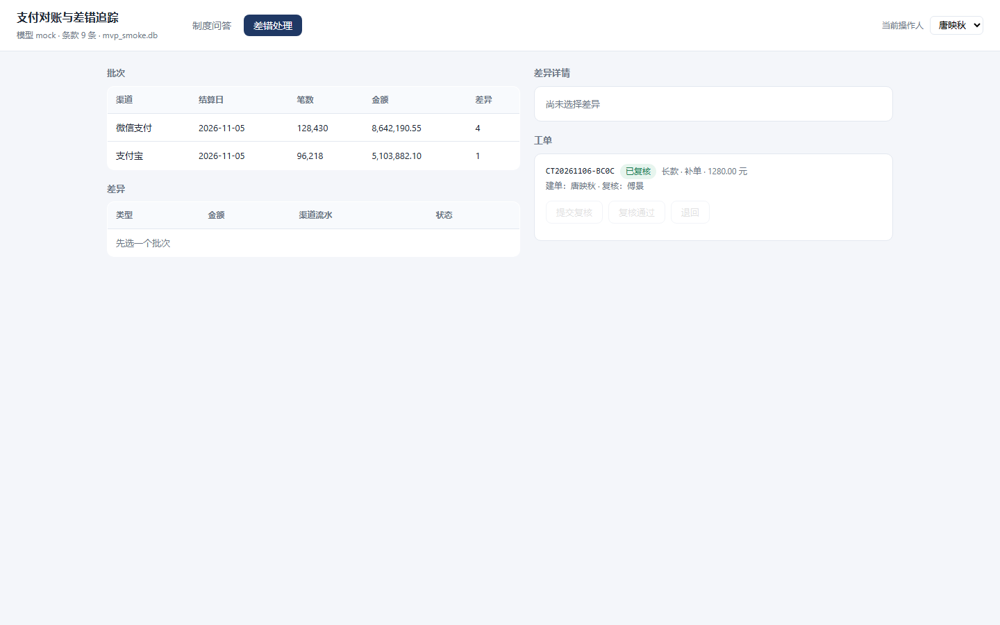
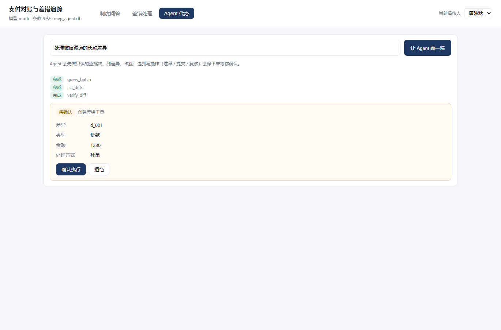

# 支付对账与差错追踪 · MVP

最小可运行系统：**制度问答（检索 + 引用）** 与 **差错处理闭环（核验 → 建单 → 提交 → 复核）**，
单进程、单文件数据库、零外部服务。不配任何 API Key 也能完整跑通。

```bash
cd src
python -m venv .venv
.venv\Scripts\activate          # macOS/Linux: source .venv/bin/activate
pip install -r requirements.txt
python run.py                   # → http://127.0.0.1:8080
```

首次启动自动建库并灌入演示数据：9 条制度条款、2 个渠道、2 个批次、5 条差异。



## 目录

```
src/
├── run.py                  一条命令启动
├── requirements.txt        fastapi + uvicorn（仅此两项）
├── app/
│   ├── main.py             路由、SSE、异常处理
│   ├── agent_loop.py       Agent 循环：工具注册表 + 三个确认门
│   ├── agent.py            核验 / 建单 / 提交 / 复核 + 凭证签名
│   ├── retrieval.py        中文二元组分词 + BM25
│   ├── llm.py              模型适配（mock / OpenAI 兼容）
│   ├── db.py               SQLite 表结构与访问
│   ├── seed.py             制度条款与演示数据
│   ├── config.py           环境变量（都有默认值）
│   ├── errors.py           统一错误体
│   └── static/             单页前端（原生 HTML/JS，无构建步骤）
├── archive/                问答助手会话归档（json + csv + 生成脚本）
└── tests/                  27 条接口级测试
```

约 2,300 行（含前端与测试），依赖只有 FastAPI 与 uvicorn。

## 两个功能

### 1. 制度问答

输入问题 → BM25 检索制度条款 → 条款作为资料喂给模型 → SSE 流式返回。

```
meta → status(retrieving) → sources → status(generating) → delta × N → done
```

`sources` 给出命中的条款号与摘要，前端渲染成「第 2.1 条《长款：渠道有、内部无》」这样的引用标签。
检索分数低于阈值时不调模型，直接返回「未找到」，避免硬编答案。

默认 `mock` 模式返回的是**条款原文摘录**（带引用），不是生成式回答——它证明的是链路通，不是模型能力。
接真实模型：

```bash
set LLM_PROVIDER=deepseek
set LLM_BASE_URL=https://api.deepseek.com/v1
set LLM_API_KEY=sk-xxx
set LLM_MODEL=deepseek-chat
```

### 2. 差错处理

选批次 → 选差异 → 核验 → 建单 → 提交复核 → 复核签核，每一步都落 `ticket_event`。

## 3. Agent 代办（人工确认门）

点「让 Agent 跑一遍」后，Agent 按剧本执行：查批次 → 列差异 → 核验，然后在**三个写操作前停下来等人确认**：

| 门 | 动作 | 确认时要看的 | 不确认的后果 |
|---|---|---|---|
| G1 | 创建差错工单 | 差异编号、类型、金额、处理方式 | 不建单，差异保持 pending |
| G2 | 提交复核 | 工单号、金额、当前状态 | 工单停在 created |
| G3 | 复核签核 | 工单号、金额、状态 | 工单停在 submitted |



设计上的三个约束：

1. **只读步骤不打断**——查批次、列差异、核验直接执行，人只在写操作前被打断；
2. **确认即带预览**——确认卡片上显示的就是即将写入的值（金额来自服务端重查，不是模型传的）；
3. **拒绝即终止**——点「拒绝」，会话置为 `aborted`，不产生任何写入。

循环实现见 `app/agent_loop.py`：工具注册表（`TOOLS`）+ 计划（`plan_for`）+ 状态机（`running / waiting_confirm / done / aborted`）。
决策点只有 `plan_for(goal)` 一处，接真实模型时替换它即可。

## 三条防线（都有测试覆盖）

| 防线 | 实现 | 测试 |
|---|---|---|
| 写接口不收金额 | `POST /api/tickets` 只收 `diff_id`/`token`/`handling`，金额从 `diff_record` 重查 | `test_create_ticket_uses_server_side_amount` |
| 建单必须持有效凭证 | HMAC-SHA256 签名 + 库内 `verify_record`（通过 / 未使用 / 未过期）+ 差异状态必须是 `pending` + `ticket.diff_id UNIQUE` | `test_create_requires_valid_token`、`test_token_single_use`、`test_same_diff_cannot_be_ticketed_twice` |
| 四眼原则 | `review` 接口在服务端比对 `operator != created_by`，不是靠前端隐藏按钮 | `test_reviewer_cannot_be_creator` |

核验本身也会拦：超过 7 天回溯窗口直接不通过（`OUT_OF_WINDOW`），超过 3000 元给 `HIGH_AMOUNT` 警告。

## 接口

| 方法 | 路径 | 说明 |
|---|---|---|
| GET | `/` | 单页应用 |
| GET | `/api/health` | 健康检查（条款数、模型、库名） |
| POST | `/api/chat` | 提问，SSE 流式返回 |
| GET | `/api/policies` | 制度条款列表 |
| GET | `/api/batches` | 批次列表（含差异数） |
| GET | `/api/diffs?batch_id=` | 差异列表 |
| POST | `/api/diffs/{id}/verify` | 核验，通过则签发凭证 |
| POST | `/api/tickets` | 建单（需凭证） |
| POST | `/api/tickets/{id}/submit` | 提交复核 |
| POST | `/api/tickets/{id}/review` | 复核（`approve` 可退回），强制换人 |
| GET | `/api/tickets` | 工单列表（含事件流） |
| POST | `/api/agent/run` | 让 Agent 执行目标，遇到确认门即返回 |
| POST | `/api/agent/{id}/confirm` | 确认或拒绝当前待办 |
| GET | `/api/agent/{id}` | 读取 Agent 会话状态 |

非流式接口统一返回 `{code, message, data, trace_id}`，`code=0` 为成功。
错误码：`10400` 参数错误、`10401` 问题为空、`10404` 不存在、`10409` 状态冲突、`10403` 越权、`10501` 模型失败、`10502` 未就绪。

## 测试

```bash
pip install -r requirements-dev.txt
pytest -q
```

27 条用例，分两组：

- `tests/test_api.py`（16 条）：健康检查、SSE 事件序列、检索兜底、核验通过与超窗拦截、凭证伪造、
  金额服务端重查、凭证一次性、同一差异不可重复建单、建单人不能复核、换人后复核通过、工单事件流；
- `tests/test_agent.py`（11 条）：计划里必须有 3 个确认门、只读目标不触发确认、运行在 G1 前停下
  且不产生工单、确认后建单并进入 G2、拒绝即终止不写入、三连确认走完整链路、建单人复核被拒（403）、
  无待办时确认返回 409、会话可回读、未知会话 404。

## 部署

`deploy/` 下是一套可直接用的部署物料：

| 文件 | 用途 |
|---|---|
| `Dockerfile` / `docker-compose.yml` | 容器化部署（推荐），数据挂卷持久化 |
| `jinrong-mvp.service` | systemd 单元（不走 Docker 时用） |
| `nginx.conf` | 反向代理，已处理 SSE 的 `proxy_buffering off` |
| `deploy.sh` | 打包上传 + 远端重启（Docker / systemd 两种模式） |
| `README.md` | 部署手册：环境要求、三种方式、升级回滚、常见问题 |

```bash
cd deploy
cp .env.example .env        # 写入 MVP_SECRET
docker compose up -d --build
curl -s http://127.0.0.1:8080/api/health
```

## 配置

| 变量 | 默认 | 说明 |
|---|---|---|
| `MVP_HOST` / `MVP_PORT` | `127.0.0.1` / `8080` | 监听地址 |
| `MVP_DB` | `src/mvp.db` | SQLite 文件 |
| `MVP_SECRET` | 启动时随机 | 凭证签名密钥；多进程部署必须显式设置 |
| `MVP_TOP_K` / `MVP_MIN_SCORE` | `3` / `0.35` | 检索条数与兜底阈值 |
| `MVP_LOOKBACK_DAYS` | `7` | 差异回溯窗口 |
| `MVP_HIGH_AMOUNT` | `3000` | 大额告警线 |
| `MVP_TOKEN_TTL` | `600` | 凭证有效期（秒） |
| `LLM_PROVIDER` / `LLM_BASE_URL` / `LLM_API_KEY` / `LLM_MODEL` | `mock` | 模型配置 |

## 与 `支付对账与差错追踪系统_交付/` 的关系

那份是完整交付版（Web 服务 + 桌面客户端 + Agent 演示 + 需求文档），代码量大、模块多。
这一份是把其中**能跑通主流程的最小集合**重写了一遍，用来：

- 一条命令启动，不依赖 numpy / PyJWT / pypdf；
- 把评审中发现的几个缺口直接修掉（旧实现里存在、这里不再存在）：

| 旧实现的问题 | 本 MVP |
|---|---|
| `ticket.diff_id` 无唯一约束，先核验两次可对同一差异建两张单 | 表上 `UNIQUE`，且建单前校验差异状态为 `pending` |
| `submit_ticket` 不校验操作人，同一账号可自建自审 | 新增 `review` 接口，服务端比对建单人 |
| 金额只做 `risk_level` 标注，不参与任何判断 | 金额一律服务端重查，`>3000` 触发告警 |
| `agent_log` 可被 `UPDATE`，审计链不成立 | 工单事件表只插入不修改，随工单返回 |
| 中文 Windows 控制台直接跑会因 `✓` 崩 | 控制台输出只用 ASCII 与中文，无特殊符号 |

## 已知边界

- **无鉴权**：操作人是前端下拉选的，只用于演示四眼原则。生产要接 SSO，操作人从会话取，不能由前端传。
- **单进程**：写路径靠一把进程内锁串行化；多实例部署要靠数据库约束与行锁（`UNIQUE` 已经具备）。
- **mock 回答是摘录**：不代表模型能力。
- **无历史会话**：问答不落库，刷新即清空。
- **SQLite**：单机够用，并发写入会排队；上量要换 PostgreSQL。
