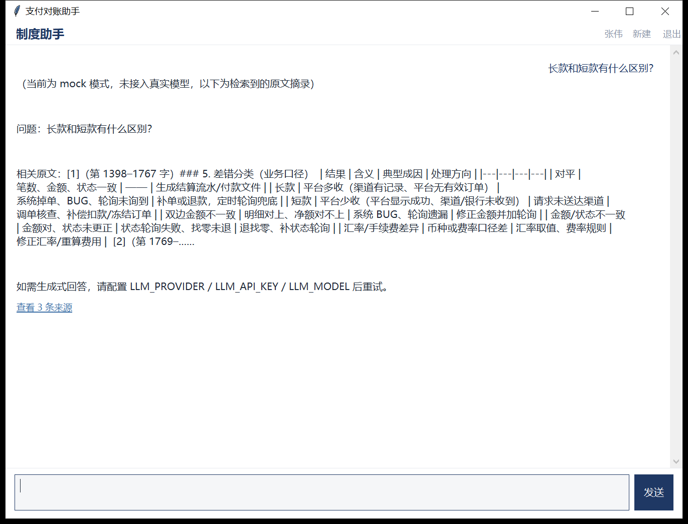
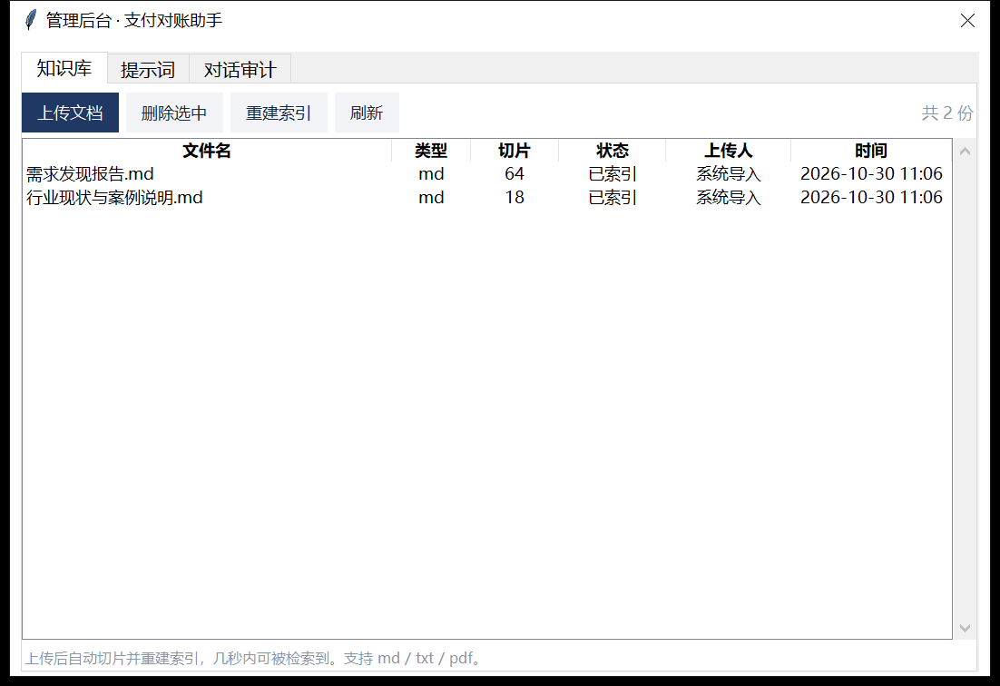
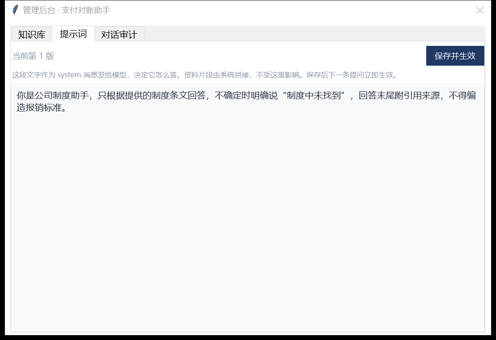
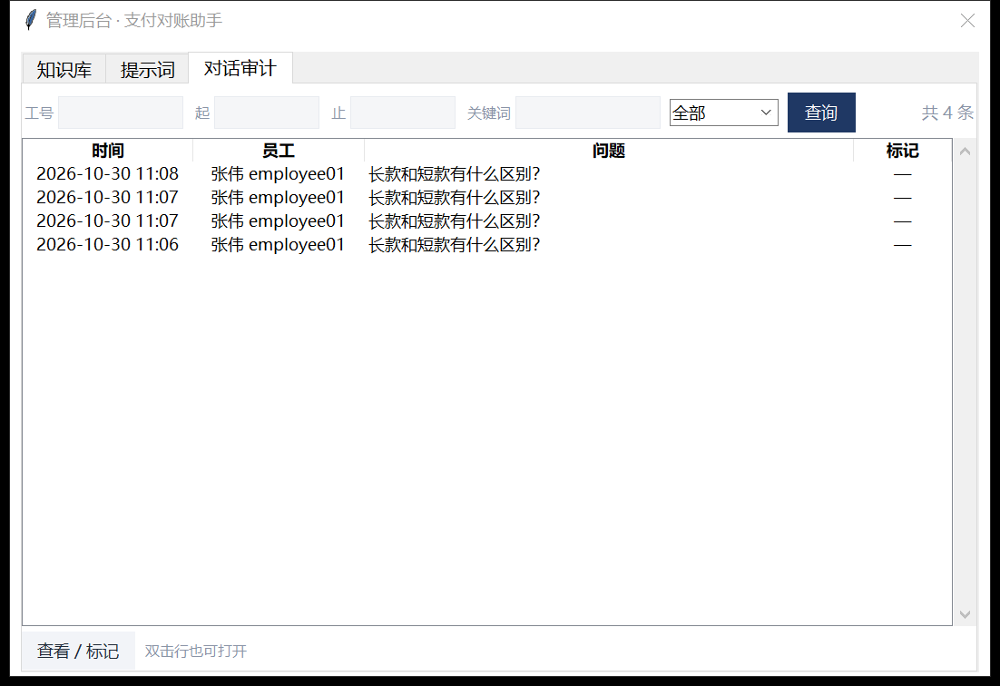

# 桌面客户端

给对账会计用的 Windows 客户端。不用开浏览器，双击即用。
管理员登录后，顶栏多一个「管理」入口，可直接在客户端里维护知识库、改提示词、查审计。

## 界面

**员工问答**



**管理后台（仅管理员可见）**

| 知识库 | 提示词 |
|---|---|
|  |  |

**对话审计**



## 设计：一屏只有三样东西

| 去掉了 | 换成了 |
|---|---|
| 彩色气泡 + "我：/助手："前缀 | 靠**对齐方式**区分：我问的靠右，回答靠左 |
| 发送、停止两个按钮并排 | **合并成一个**，状态切换（发送 ⇄ 停止） |
| 独立状态栏 | 状态写在对话里（"正在检索制度…"），收到第一个字自动消失 |
| 三条来源逐行铺开 | 折成一行「查看 3 条来源」，点开才是列表 |
| 顶部三个按钮 | 三个文字链接（新建 / 管理 / 退出），"管理"仅管理员显示且用主色标出 |

配色只留四个：白底、正文黑、辅助灰、主色深蓝（#1f3864）。

## 管理员入口

登录管理员账号后：

- 顶栏出现**主色**的「管理」（不是灰色链接，避免找不到）；
- 点开是独立窗口，三个页签：
  - **知识库**：列表、上传（md/txt/pdf）、删除、重建索引
  - **提示词**：查看当前版本、编辑、保存后**立即生效**
  - **对话审计**：按工号/日期/关键词/是否标记筛选，双击看问答全文与引用，可标记或取消标记
- 不再跳浏览器。之前是 `webbrowser.open('/admin')`，会丢掉客户端里的登录态和上下文。

## 启动

1. 起服务端：

```bash
cd webapp
python -m uvicorn app:app --host 127.0.0.1 --port 8000
```

2. 双击 `启动客户端.bat`

3. 员工账号进问答；管理员账号登录后顶栏可见「管理」

## 四个实现上的坑（都已处理）

**① 高 DPI 模糊**
不声明 DPI 感知时 Windows 会把窗口当位图放大到 150%，字全糊。
启动时调 `SetProcessDpiAwareness(1)`，并把 `tk scaling` 设成 `96*DPI/72`——
只做前者字会反过来变得很小，两个要一起改。

**② 控件跨线程**
tkinter 只能在主线程改控件。网络跑子线程 → 事件进 `queue` → 主线程 `after(60ms)` 渲染。
跨线程直接写控件会偶发崩溃且无法复现。

**③ 空状态**
没有消息时中间显示两行灰字，发出第一条后清掉；不用占位符（会和焦点事件打架）。

**④ 审计页懒加载**
开窗时不请求，切到审计页才查——不点不看，省一次请求。

## 结构

```
client/
├── api.py          传输层：登录、SSE 流式、管理端接口（可单独测试）
├── app.py          界面层：问答页
├── admin_ui.py     界面层：管理后台（三页签）
├── 启动客户端.bat
├── preview*.png
└── client_state.json   上次的服务器地址与工号（自动生成，不存密码）
```

## 已知限制

- 无离线缓存，断网不可用
- 关闭后不自动恢复上次对话（接口已有，UI 未接）
- 单会话，不支持多标签
- 审计标记的分类是固定四类（超标准/非因公/虚构/其他），要改需要同时改服务端枚举
- HTTPS 未做证书校验（内网 http 够用，公网部署要补）
